# 🌊 BaseFlow

BaseFlow is an advanced, interactive codebase visualization and AI-assisted software architect platform. It maps out complex code repositories as structured, interactive 2D mindmaps while integrating an autonomous AI assistant powered by **Google Gemini API** (using the Google ADK) to help developers inspect components, perform refactoring risk analysis, and orchestrate automated fixes.

---


## ✨ Features

### 🧠 Core Capabilities
- 🔍 **Multi-Language AST Codebase Parser**: Traverses files recursively to construct structural models using the official `typescript` compiler API for TypeScript/JavaScript/Vue, and regex-based parsers for Python, Java, and C#.
- 🗺️ **Interactive 2D Mindmaps**: Renders classes, modules, inheritance (`extends`), interface implementations (`implements`), and dependency usages in a clean, hierarchical force-directed graph layout.
- 🤖 **Autonomous AI Architect Agent**: Integrates Google's Agent Development Kit (`@google/adk`) with a choice of **Gemini, Claude or OpenAI** models (switchable in the chat). The agent has **16 tools** to inspect code, navigate the UI, highlight mindmap nodes, write files, and interact with DevOps platforms.
- 🏗️ **AI Architecture Diagrams**: Auto-generates system architecture and class interaction diagrams using Mermaid.js.
- 📄 **Document Q&A**: Analyzes markdown documents in your repository and answers questions in context.

### 🚀 New — AI DevOps Intelligence (GitLab/GitHub Agent Platform)

> **GitLab Duo MCP integration** — connects to the official GitLab Duo MCP endpoint at `https://gitlab.com/api/v4/mcp`.
> See [GitLab Duo MCP Integration](docs/GITLAB_DUO_INTEGRATION.md) for full setup instructions.

> **GitHub Copilot MCP integration** — connects to the official GitHub MCP endpoint at `https://api.githubcopilot.com/mcp/`.
> See [GitHub Copilot MCP Integration](docs/GITHUB_COPILOT_INTEGRATION.md) for full setup instructions.

- 📊 **DevOps Health Score**: Computes a real-time score (0–100) across open issues, MRs, and pipeline success rate. The AI agent produces a full narrative report with charts and prioritized recommendations.
- 🤖 **AI Issue Resolver & Auto-Create MR**: Click any GitLab/GitHub issue → the agent reads it via MCP, finds relevant codebase classes, writes a structured fix playbook, and **automatically creates a Merge Request** with the fix.
- 🛠️ **Gemini CLI Modified Files Navigator**: Renders files modified by the Gemini CLI inside assistant chat bubbles as clickable links. Clicking a file link instantly navigates to and highlights the file in the Codebase Explorer.
- 📥 **Interactive Code Review & Diff Viewer**: Displays inline color-coded diff highlights comparing local workspace changes against Git HEAD (supporting both tracked and new untracked files) directly inside the codebase explorer view.
- 💾 **Header Source Downloader**: Quick download button in the CodeViewer header panel to retrieve any text-based code file directly.
- 🔍 **AI MR Code Review**: BaseFlow fetches the MR diff via GitLab MCP and posts inline AI review comments directly to GitLab with a single click.
- 🛡️ **Codebase Security Audit**: Scans your codebase structure for vulnerabilities. Risky components are instantly highlighted in RED on the interactive mindmap with warning shields.
- 🔍 **CI/CD Watchdog**: Click any failed pipeline → the agent fetches the job log via `gitlab_get_job_trace`, cross-references it with your codebase, highlights affected classes on the mindmap, and generates root-cause analysis.
- 📤 **Multi-Agent GitLab Duo AI Catalog & GitHub Copilot Integration**: Formats any generated skill file as a Custom Agent system prompt and prepares it for publication to the [GitLab Duo AI Catalog](https://docs.gitlab.com/user/duo_agent_platform/ai_catalog/) and [GitHub Copilot](https://docs.github.com/en/copilot).
- 📈 **Real-Time Remote DevOps Metrics**: Automatically fetches and caches (24h) live commit activity, stars, and forks from the GitHub/GitLab REST APIs to power the Dashboard Activity charts.
- 💬 **Context-Aware Document Analysis**: Chat directly with AI about any Markdown document or Playbook using the integrated "Ask Agent" feature with pre-generated contextual suggestions.

### ⚙️ Platform
- 🔗 **Dual MCP Integration**: GitLab Duo MCP + GitHub MCP running concurrently in the same agent session.
- 🌐 **Modern Responsive UI**: Vue 3, Vite, Element Plus — Dark/Light mode, EN/VI localisation, SSE streaming. Optimized with `markRaw` for rendering massive codebase graphs without UI freezing.
- 🐳 **Docker + Cloud Run Ready**: Single-container deployment to Google Cloud Run. See [Cloud Run Deployment](docs/CLOUD_RUN_DEPLOY.md) for full setup instructions.

---

## 📸 Screenshots & Visual Tour

### 📊 Repository Dashboard & Overview
*Compute live commit metrics, total class counts, language percentages, and Git activity trends.*
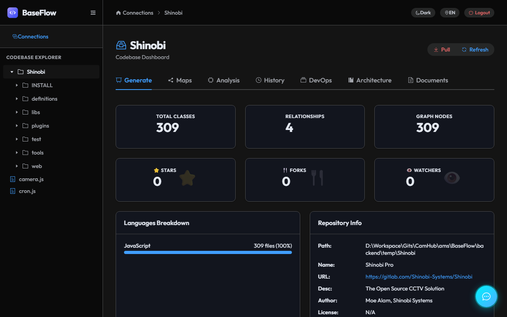

### 🗺️ G6 Interactive Codebase Mindmap
*Traverse package directory trees visually. Auto-focus node cameras and switch between Mindmap and Neural Map layouts.*
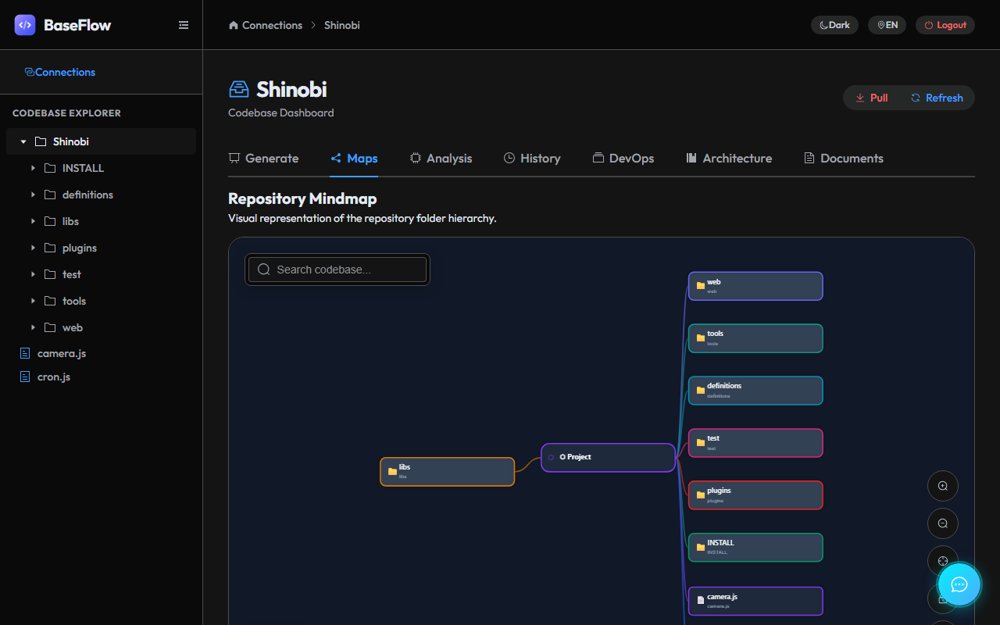

### 🔍 Class Inspector & UML ERD Drawer
*Single-click class nodes to inspect fields/methods or double-click to draw UML Entity-Relationship dialogues.*
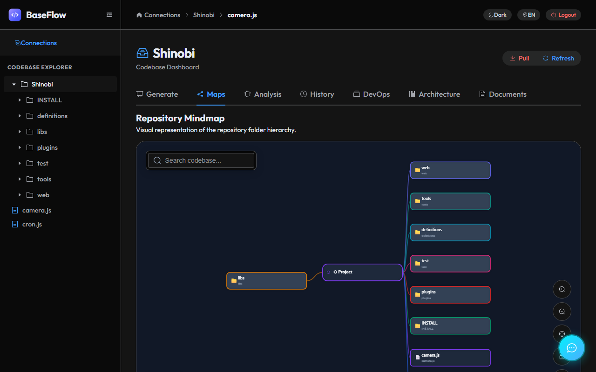


### 🛡️ AI DevOps Workspace & Security Audits
*Compute DevOps health indexes, generate onboarding guides, and run codebase security audits (vulnerability warning nodes highlighted in RED).*
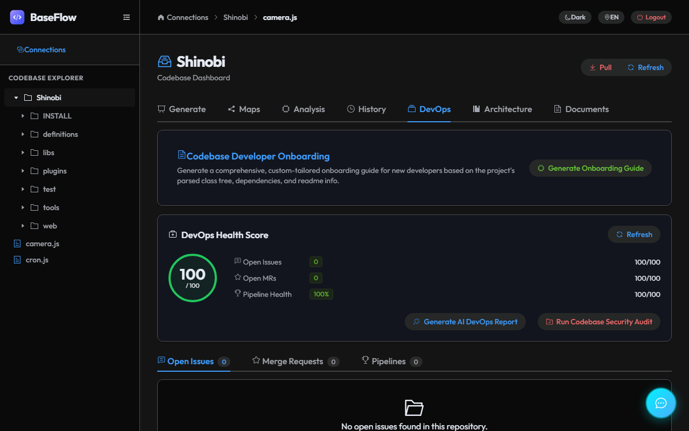
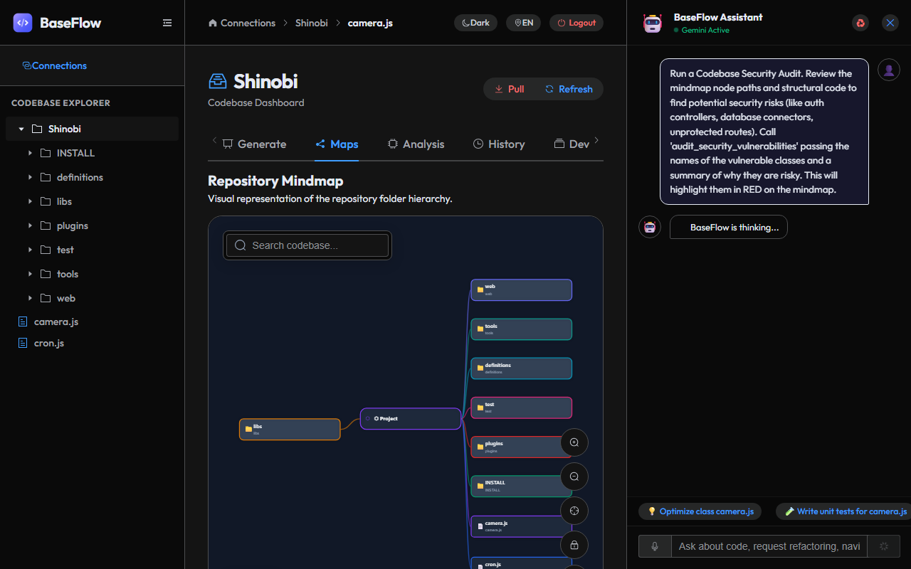

### 🏗️ System Architecture Mermaid Diagrams
*Deconstruct imports and module interaction maps automatically into zoomable, fullscreen Mermaid flowcharts.*
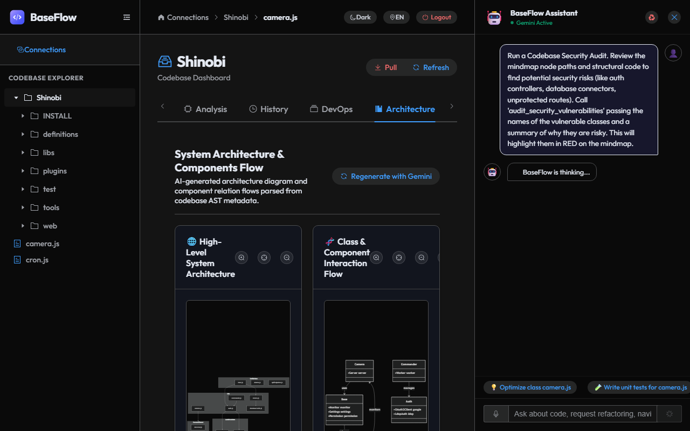

### 📄 AI Document Playbooks & Q&A
*Read repository Markdown files, prompt agent Q&A chat drawers, and prepare skill playbooks for Copilot/Duo.*
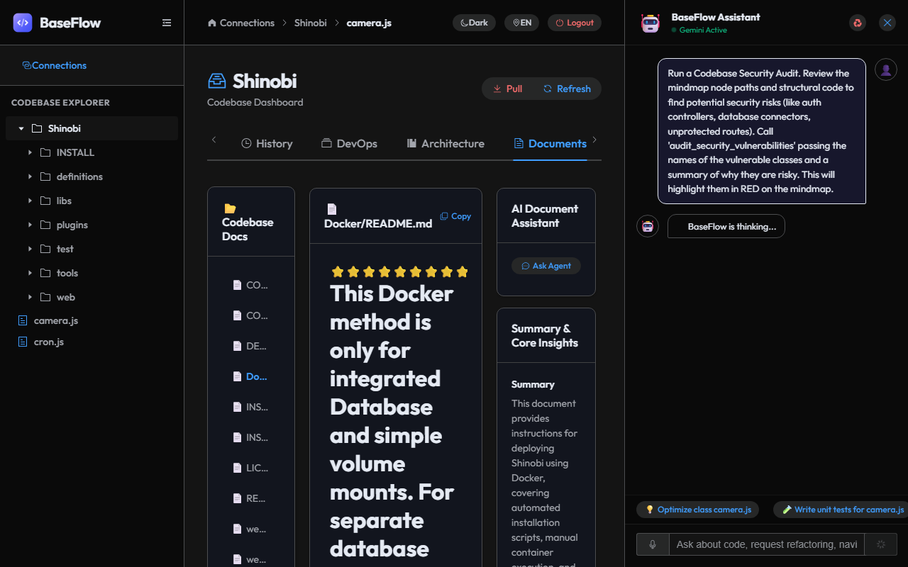

### 💻 Sidebar Explorer & Selection Chat
*Expand folder trees in the sidebar, view source code with line-highlighting, and select text to invoke SRE chat bubble.*
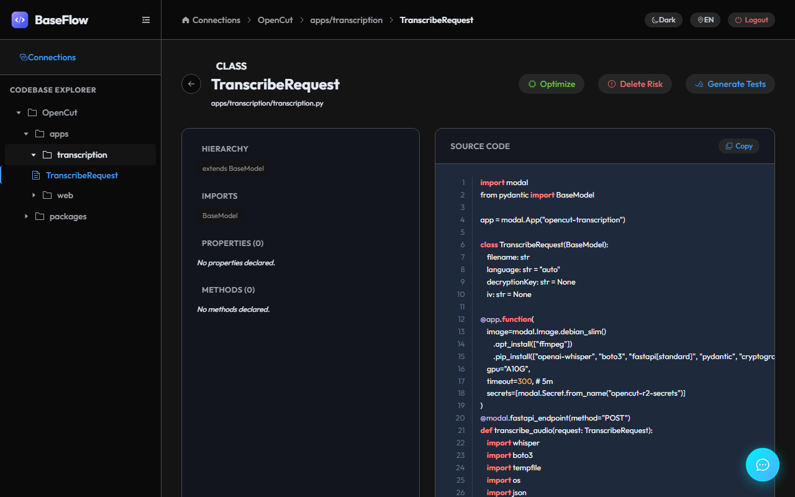

### 🤖 Conversational Chatbot Assistant
*Slide open the Gemini assistant sidebar to optimize classes, write test suites, or ask freeform queries.*
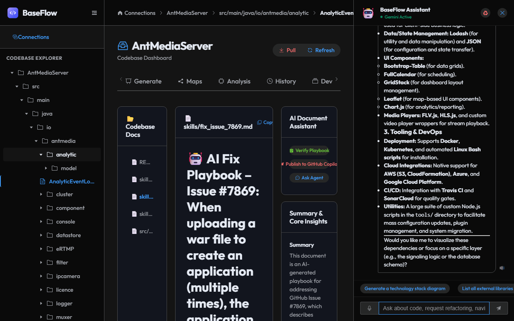

---

## 🏗️ Architecture & Technology Stack

BaseFlow runs as a unified containerized service hosting both backend API services and frontend assets.

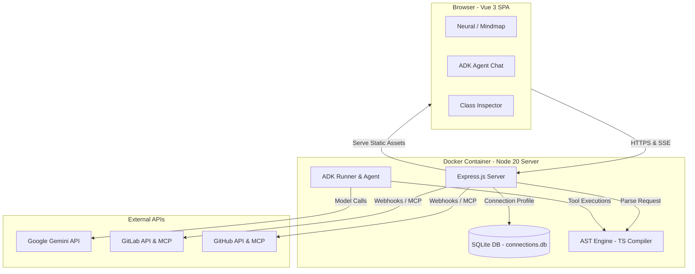

### 🔮 3D Visual Architecture Flow
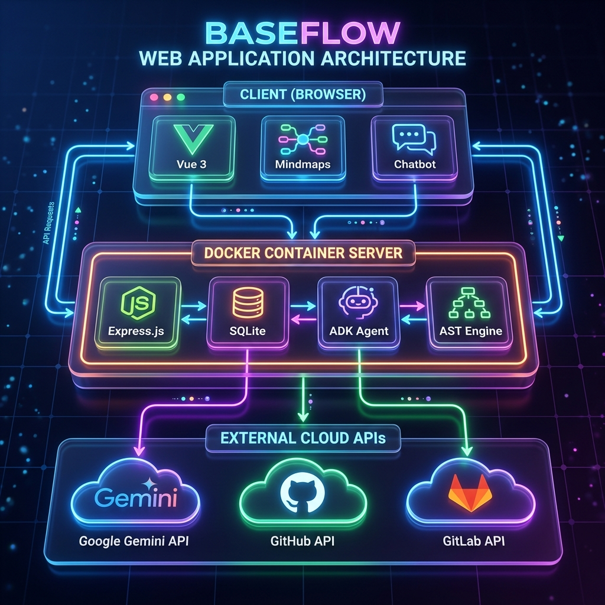

### Components
1. **Backend** ([backend/](backend/)):
   - **Express**: Exposes authentication, connection configurations, and repository details endpoints.
   - **SQLite**: Manages connection configurations inside an encrypted SQLite database using `sqlite3` and `sqlite`.
   - **AST Engine**: Gathers structural metrics and maps components to custom mindmap coordinates.
   - **ADK Agent**: Orchestrates LLM actions using the `@google/adk` package (with MCP toolsets for GitHub/GitLab).
2. **Frontend** ([frontend/](frontend/)):
   - **Vue 3 / Vite**: Hot-reloadable single-page application framework.
   - **Pinia**: Core state engine managing active repositories, connection profiles, and authentication states.
   - **Element Plus**: Responsive UI library powering forms, layouts, drawers, and notifications.
   - **G6 Graph** : Graph visualization engine. It provides basic capabilities for graph visualization and analysis such as drawing, layout, analysis, interaction
3. **Tests & CI**:
   - Backend unit tests in [backend/test/](backend/test/) (`npm test`): security, per-session agent isolation, and the Claude/OpenAI adapters driving a real ADK agent with mocked SDK clients, run with type checks and the frontend build on every push/PR via [GitHub Actions](.github/workflows/ci.yml).

---

## 🛠️ Local Development Setup

### Prerequisites
- **Node.js** (v20+ recommended)
- **Git** installed and available in your environment path
- **Google Cloud Agent API Key** (from [Google Cloud Agent](https://console.cloud.google.com/agent-platform))

### 1. Backend Setup
1. Navigate to the backend directory:
   ```bash
   cd backend
   ```
2. Install dependencies:
   ```bash
   npm install
   ```
3. Create a `.env` file inside the `backend/` folder:
   ```env
   PORT=5000
   PASSWORD=change_me_strong_password
   # openssl rand -hex 32 (required in production, keep ENCRYPTION_KEY stable)
   ENCRYPTION_KEY=
   SESSION_SECRET=
   GOOGLE_API_KEY=your_google_agent_api_key_here
   AGENT_MODEL=gemini-3.1-flash-lite
   GOOGLE_GENAI_USE_VERTEXAI=1
   ```
4. Run the server in development (hot-reload) mode:
   ```bash
   npm run dev
   ```
   The backend will start on [http://localhost:5000](http://localhost:5000).

### 2. Frontend Setup
1. Navigate to the frontend directory:
   ```bash
   cd ../frontend
   ```
2. Install dependencies:
   ```bash
   npm install
   ```
3. Start the Vite dev server:
   ```bash
   npm run dev
   ```
   Open the browser at [http://localhost:5173](http://localhost:5173) to view the console.

---

## 🧪 Running Automated Tests

```bash
npm test            # backend unit tests (path containment, URL validation, encryption, rate limiting)
npm run typecheck   # backend tsc + frontend vue-tsc
npm run e2e         # end-to-end browser tests (Playwright)
```

The end-to-end suite in [e2e/](e2e/) builds the frontend, starts the real backend in production mode against mock Anthropic / OpenAI APIs (no keys, no cost) and drives Chromium through login, connections, chat, model switching, reload and the conversation list. First run: `npx playwright install chromium` inside `e2e/`. CI runs it after the backend and frontend jobs.

---

## 🧠 Chat Model Providers

The assistant runs on **Gemini**, **Claude** (Anthropic) or **OpenAI**. Every provider whose key is configured appears in the model picker at the top of the chat sidebar; the choice is remembered per browser. All three share the same agent, the 16 tools, GitHub/GitLab MCP and per-session state — Claude and OpenAI are plugged into ADK through model adapters in [backend/src/llm/](backend/src/llm/).

| Variable | Default | Description |
|---|---|---|
| `LLM_PROVIDER` | first configured | Default provider for the chat and for text generation (README, class and document analysis, diagrams): `gemini`, `anthropic` or `openai` |
| `GOOGLE_API_KEY` | – | Gemini (or Vertex AI via `GOOGLE_GENAI_USE_VERTEXAI`) |
| `AGENT_MODEL` | `gemini-3.1-flash-lite` | Gemini model |
| `ANTHROPIC_API_KEY` | – | Claude |
| `ANTHROPIC_MODEL` | `claude-opus-5-5` | Claude model |
| `ANTHROPIC_EFFORT` | `medium` | `low` / `medium` / `high` / `xhigh` / `max` — higher effort is more thorough and costs more tokens |
| `ANTHROPIC_SERVER_FALLBACK` | on | Server-side refusal fallback (`fallbacks: "default"`) for models that support it; set `off` if a proxy rejects it |
| `OPENAI_API_KEY` | – | OpenAI |
| `OPENAI_MODEL` | `gpt-5.5` | OpenAI model |
| `OPENAI_BASE_URL` | – | Any OpenAI-compatible endpoint |
| `OPENAI_REASONING_EFFORT` | – | Optional `reasoning_effort` for reasoning models |

Notes:
- Claude requests stream with prompt caching on the system prompt and tools, keep thinking blocks unchanged across tool calls, and never run a tool call that was cut off (`max_tokens`) or refused.
- **Playbook execution** (`execute_playbook_with_gemini_cli`) always uses the Gemini CLI, so it still needs Gemini credentials.

---

## 🔐 Security Configuration

| Variable | Required in production | Description |
|---|---|---|
| `PASSWORD` | ✅ | Login password (≥ 8 chars, not `admin`). Login is rate-limited (10 failures / 15 min / IP). |
| `SESSION_SECRET` | ✅ | ≥ 32 random chars (`openssl rand -hex 32`). |
| `ENCRYPTION_KEY` | ✅ | ≥ 32 chars, **keep stable** — Git URLs and tokens are encrypted at rest with AES-256-GCM. Data written by older versions is migrated automatically. |
| `CORS_ORIGINS` | – | Extra origins allowed to call the API with cookies. Same-origin needs nothing. |
| `ALLOWED_LOCAL_ROOTS` | – | Folders "local" connections may use. Unset ⇒ any folder in development, **disabled** in production. |
| `SESSION_DB_URL` | – | Where agent conversations are stored: `sqlite:///path/agent_sessions.db` (single host) or `postgres://…` (several instances). Unset ⇒ in memory, conversations are lost on restart. |

With `NODE_ENV=production` (the default in the Docker image) the server **refuses to start** with missing or default secrets. Other safeguards:

- Every file access (API and agent tools) is confined to the repository workspace, symlinks included; the agent cannot write to `.git/`, `.github/workflows/` or `.gitlab-ci.yml`.
- External commands run without a shell (`execFile`), so file names and URLs cannot inject commands.
- Gemini CLI playbooks run with a minimal environment that never contains the server secrets or Git tokens, and in `auto_edit` approval mode: file edits are auto-approved, shell commands and web fetches are not run (`GEMINI_CLI_APPROVAL_MODE=yolo` opts back into auto-approving everything). Edits still come from repository and issue content, so review generated MRs/PRs before merging.
- Markdown from repositories, issues and the LLM is rendered without raw HTML, and Mermaid uses `securityLevel: 'strict'` (XSS protection).
- MCP tokens are passed through environment variables, not command-line arguments.
- Login sessions are HMAC-signed cookies (`httpOnly`, `SameSite=Lax`, `Secure` in production): they survive restarts and work across instances. The signing key is derived from `SESSION_SECRET` and `PASSWORD`, so changing either signs everyone out. Saved chats are tied to a separate signed per-browser cookie (`baseflow.device`, 1 year), so they survive logout, re-login and the login expiry; that cookie grants no access on its own. The 🕘 button in the chat sidebar lists this browser's saved conversations to resume, or starts a new chat.
- Agent state (scanned repository, pending UI actions, modified files) is isolated per chat session; each chat session is tied to the login session and to its own connection, so the agent cannot be steered into another repository.

---

## 🚀 Cloud Run Deployment

BaseFlow is optimized to deploy to **Google Cloud Run** in a single consolidated container.

### Prerequisites
1. Installed **Google Cloud SDK** (`gcloud` CLI).
2. Authenticated account:
   ```bash
   gcloud auth login
   ```
3. An active GCP Project ID with Billing, **Cloud Run API**, and **Cloud Build API** enabled.

### Deploying
Open the deploy script matching your operating system inside the project root:
- **Windows (Command Prompt)**: Run [deploy_cloud_run.cmd](deploy_cloud_run.cmd)
- **Unix / macOS**: Run [deploy_cloud_run.sh](deploy_cloud_run.sh)

The deployment script executes a remote container build via Cloud Build utilizing the multi-stage [Dockerfile](Dockerfile) and registers the service at port 5000. 

> [!IMPORTANT]
> Before deploying, set `APP_PASSWORD`, `APP_ENCRYPTION_KEY` and `APP_SESSION_SECRET` (export them or edit the top of the script) — the script aborts otherwise. Also configure `GOOGLE_API_KEY` and `AGENT_MODEL` to enable the AI Architect features.

## 👤 Developer

- **Name:** Minh Truong
- **GitHub:** [@camtruong512](https://github.com/camtruong512)

## 👤 Supporter

- **Name:** Tan Do
- **GitHub:** [@dmtan90](https://github.com/dmtan90)
---

## 📄 License
This project is licensed under the MIT License - see the [LICENSE](LICENSE) file for details.
